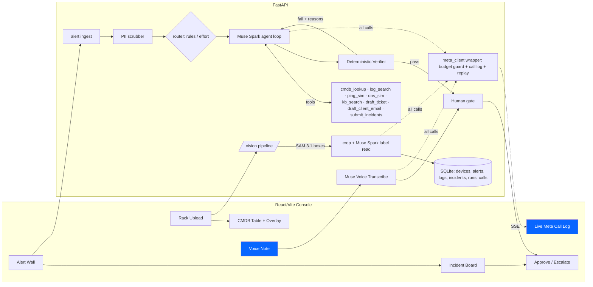

# RackWatch: Design Spec (build-ready, no code)

> Working name **RackWatch** ("from rack photo to resolved incident"). Alternatives: RackSense, NOCturne.
> Meta Global AI Developer Hackathon · Track: **Indie** · Problem statement: **Build for Your World**
> Submission due **Wed Nov 4, 9:00 PM ET**. Internal freeze: **Wed Nov 4, 6:00 PM ET**.
> Rubric: Impact 30 · Meta tooling 25 · Demo 25 · Technical depth 20. Bonus targets: **Best Agentic**, **Most Viral** (stretch: Best Open Weight).

Verification legend: **[V]** verified on Nov 2 2026 against the quickstart, the cookbook, or legal-agent-workshop source. **[U]** unverified: confirm at build time with the preflight script (M1).

---

## 1. Problem and users

MSPs (managed service providers) run IT for dozens of small clients, with a few techs on night shift. There are two kinds of pain:
1. **Unknown inventory.** A client's CMDB is stale or empty. Someone has to walk the closet, read labels, and type serials into the PSA. That takes hours per rack.
2. **Alert floods.** One failed switch fires hundreds of RMM alerts (host down, backup failed, VoIP jitter, DNS timeouts) across many devices. The tech at 2 AM has to work out that it is *one* incident, find the cause, open a ticket, and email the client, without stating anything false.

**Users:** an MSP NOC tech (primary), the MSP service manager (approves and escalates), and the end client (receives the email).
**Value:** rack photo to CMDB in under 60 s. 500 alerts to 3 verified incidents, each with a ticket and client email drafted, in under 3 min. Every claim cites a log line, and a human signs off.

Not a banned category. It is not basic RAG and not a simple image analyzer: vision feeds a structured system of record, which then grounds a multi-tool agent checked by an external verifier.

## 2. Demo story (the arc)
1. "It's 2:07 AM. 512 alerts." A wall of red.
2. Drop in a **photo of the client's rack**. SAM 3.1 boxes each device, Muse Spark reads the labels, and the CMDB fills: 14 devices, each with its U position.
3. Click **Triage**. The live call log streams Meta API calls. The agent calls `cmdb_lookup`, `log_search`, `ping`... The alert wall collapses into **3 incidents**. Incident A: "41 alerts → core switch SW-CORE-01 in **U12**, port-channel flap, log L-0193."
4. The verifier **fails** the first plan: one claim has no citation and the fix "factory reset switch" is not on the allow-list. The agent re-plans, and the second attempt passes (green).
5. The tech records a **voice note** ("I'm onsite, the switch is power-cycled"), and Muse Voice Transcribe adds it to the ticket.
6. The manager clicks **Approve**, and the ticket and client email are exported. A metrics card shows 512 → 3, grouping F1 1.0, $0.41 spent, 2m38s.
7. "No API key? Click Replay." Judges see the same run, recorded.

## 3. Architecture



Every Meta call goes through one wrapper, `meta_client.py`. It handles budget checks, logs each call to the `calls` table and the SSE stream, and records and serves cassettes for replay mode.

## 4. Tech stack
- **Backend:** Python 3.11, FastAPI, Uvicorn, `openai` Python SDK (Responses API) pointed at `https://api.meta.ai/v1` [V]; `requests` for ASR; Pydantic v2; SQLite via `sqlite3` (or SQLModel); Pillow + OpenCV-headless (crop, overlay, video frame sampling); `sse-starlette`.
- **Frontend:** **React + Vite + TypeScript**, Tailwind. Picked over HTMX because the live incident collapse animation and the SVG box overlay are core demo moments. Uses the `MediaRecorder` API for voice capture. Optional browser `speechSynthesis` for read-back, which the rules allow.
- **Tests:** pytest, plus a FakeMetaClient (same pattern as legal-agent-workshop `tests/fake_model.py`).
- **No non-Meta model at runtime.** No embeddings: `kb_search` uses BM25 (`rank_bm25`), which is not a model. No outside OCR. No outside TTS.

## 5. Meta models and API facts

| Use | Model id | Endpoint | Status |
|---|---|---|---|
| Agent, label reading, video frames | `muse-spark-1.3` (fallback `muse-spark-1.1`) | `POST https://api.meta.ai/v1/responses` via `client.responses.create` | [V] quickstart |
| Device segmentation | `sam-3.1` (env `SAM_MODEL`) | same Responses endpoint, `input_text` concept prompt + `input_image` data URL | [V] legal-agent-workshop `check_signatures.py` |
| Voice note | `muse-voice-transcribe-1.0` | `POST https://api.meta.ai/v1/asr/transcribe` (multipart: `request` JSON part + `audio` part), `Authorization: Bearer`; streaming `wss://api.meta.ai/v1/asr/realtime` | [V] cookbook `06_muse_voice/01_voice_api_fundamentals/utils.py` |
| Key check | n/a | `GET https://api.meta.ai/v1/models` | [V] workshop handbook |
| Stretch router | `muse-glimmer-30b` LoRA SFT on Fireworks; Spark Open = `accounts/fireworks/models/muse-spark-open` | Fireworks API | [V] deck; Glimmer serverless inference was retired Sep 25, so a **deployed** LoRA is needed [U: cost/latency] |

Facts:
- **Context and output.** Spark has a 1,048,576-token context and 131,072 output tokens. Input can be text, image, PDF, or video [V].
- **Key handling.** The OpenAI SDK does **not** read `MODEL_API_KEY` automatically, so pass `api_key=os.environ["MODEL_API_KEY"]` explicitly [V]. Base URL override: `MODEL_API_BASE_URL` (workshop convention) [V].
- **Reasoning.** Pass `reasoning={"effort": "low"|"high"}` [V in quickstart response object and cookbook CUA config; exact accepted level set is U. The deck mentions 6 levels on Fireworks]. Add `include=["reasoning.encrypted_content"]` and replay prior `response.output` items in the agent loop so reasoning carries across turns [V].
- **Structured output.** `text={"format":{"type":"json_object"}}` is [V] (used in the workshop). `json_schema` strict mode is [U]. Preflight must test it, then fall back to json_object + Pydantic validation + one repair retry.
- **Tool calling.** Responses-style `tools=[{"type":"function","name":...,"parameters":{...}}]`. The model returns `function_call` items, and the harness appends `function_call_output` items with `call_id` [V, workshop progress.py].
- **Usage.** `usage.input_tokens`, `input_tokens_details.cached_tokens`, `output_tokens` (which includes reasoning tokens) [V]. Use these for the budget meter.
- **SAM output.** SAM returns special-token text in `output_text`, e.g. `0<|box;x1=..;y1=..;x2=..;y2=..;w=..;h=..|><|mask;...|>,1<|box;...|>`. Parse it with the regex `(\d+)<\|box;x1=(\d+);y1=(\d+);x2=(\d+);y2=(\d+);w=(\d+);h=(\d+)\|>` [V]. Masks are ignored in the MVP. Coordinate space (original pixels vs resized) is [U], so check it on a test image. Concept prompts that work for rack gear are [U]; candidates are "rack-mounted device", "network switch", "server", "patch panel", "device label sticker". Note from the workshop: SAM missed "signature" but found "ink scribble", so **prompt-sweep at M1**.
- **ASR.** The request JSON is `{"mode":"PUSH_TO_TALK","model":"muse-voice-transcribe-1.0","audioEncoding":"WAV","keywords":[...]}`. The response is `{sessionId, transcript, audioDurationMs, turns}`. Limits: 10 min / 32 MB. The audio must be WAV (mono 16-bit, 16 or 24 kHz). The browser records webm, so **the backend transcodes with ffmpeg** to WAV 24 kHz mono [V format; transcoding is our choice]. Pass keywords from the CMDB (hostnames, "U12").
- **Pricing.** Meta API preview pricing is unpublished. The cookbook says "the preview is free" [U]. For budgeting, use Fireworks Spark Open rates of $1.25 in / $4.25 out per 1M tokens [V deck] as a conservative proxy.

## 6. Repo layout
```
rackwatch/
  README.md  LICENSE  NOTICE.md  THIRD_PARTY.md  SECURITY.md  DATA.md  .env.example  .gitignore
  MUSE_CODE.md  DESIGN.md
  docs/muse-code-log.md  docs/architecture.md  docs/screenshots/
  backend/
    app/main.py                # FastAPI app, routes, SSE
    app/config.py              # env, budgets, REPLAY flag
    app/db.py  app/schemas.py  # SQLite DDL + Pydantic models (shared contract)
    app/meta_client.py         # the ONLY place that talks to api.meta.ai
    app/budget.py  app/replay.py
    app/pii.py                 # scrubber
    app/agent/loop.py  app/agent/prompts.py  app/agent/tools/*.py  app/agent/router.py
    app/verifier/verify.py  app/verifier/allowlist.yaml
    app/voice.py
    vision/                    # *** MUSE CODE OWNS ***
      pipeline.py  sam.py  label_reader.py  overlay.py  prompts.py  video.py
    tests/
  datagen/                     # *** MUSE CODE OWNS ***
    generate.py  scenario.yaml  templates/
  data/
    rack/sample_rack.jpg       # a photo we take, or a CC0/our own render (no client imagery)
    generated/ alerts.jsonl logs.jsonl kb/*.md ground_truth.json cmdb_seed.json
    replay/<run_id>/cassette.jsonl  replay/<run_id>/meta.json
  frontend/ (Vite React TS)
    src/pages/{Rack,Alerts,Incidents,IncidentDetail,Calls}.tsx
  scripts/ preflight.py  record_replay.py  cost_report.py
```

## 7. Data models (SQLite + Pydantic, the shared contract)

**devices** (CMDB)
| col | type | notes |
|---|---|---|
| id | TEXT PK | `dev_<rack>_<u>` |
| rack_id | TEXT | e.g. `RACK-A` |
| u_start, u_end | INT | 1 = bottom. A 2U device has u_end = u_start+1 |
| device_type | TEXT enum | switch, server, firewall, router, ups, pdu, patch_panel, storage, kvm, blank, other |
| make, model, serial | TEXT nullable | null if unreadable, never guessed |
| hostname | TEXT nullable | from the label or the seed |
| mgmt_ip | TEXT nullable | |
| confidence | REAL 0..1 | per device |
| field_confidence | JSON | `{make:0.9, model:0.8, serial:0.4, u:0.95}` |
| bbox | JSON | `{x1,y1,x2,y2}` in image pixels |
| source_image | TEXT | path |
| source | TEXT | `vision` / `seed` / `manual` |
| needs_review | BOOL | confidence < 0.6 or serial checksum fails |

**alerts**: id, ts (ISO), source (`rmm`/`psa`/`snmp`/`syslog`), client_id, device_hint (hostname/ip as raw), device_id (resolved, nullable), severity (`info|warning|critical`), type (e.g. `host_down`, `backup_failed`, `voip_jitter`, `dns_timeout`, `disk_full`, `cpu_high`, `port_flap`, `cert_expiring`), message, raw (JSON), scrubbed_message.
**logs**: id (`L-0001`…), ts, device_id, facility, level, line (scrubbed). FTS5 virtual table `logs_fts`.
**kb_articles**: id, title, body, approved_fixes[].
**incidents**: id, run_id, title, root_cause_device_id, root_cause, alert_ids[], claims[], proposed_fix_id, ticket (JSON), client_email (JSON), status (`draft|verified|failed|approved|escalated`), voice_notes[], created_at.
**runs**: id, kind (`vision|triage`), mode (`live|replay`), started_at, finished_at, attempts, cost_usd, tokens_in, tokens_out, status.
**calls** (the visible call log): id, run_id, ts, model, endpoint, purpose, effort, latency_ms, tokens_in, tokens_cached, tokens_out, est_cost_usd, status, request_digest (sha256, prompts truncated), response_excerpt (≤500 chars), replayed BOOL. **Never store the key or auth headers.**

**Incident claim** (Pydantic):
```json
{"id":"c1","text":"SW-CORE-01 port-channel Po1 flapped at 02:03:11","citations":["L-0193","L-0194"],"kind":"root_cause|impact|timeline|evidence"}
```

**VerifierResult**:
```json
{"run_id":"...","attempt":1,"passed":false,
 "checks":[{"rule":"R1_citations_exist","passed":false,"detail":"claim c3 has no citations","incident_id":"INC-2"}],
 "grouping":{"precision":0.95,"recall":0.97,"f1":0.96,"ari":0.93,"unassigned_alerts":4},
 "feedback_for_agent":"Fix: ... (plain text, deterministic, generated from failed checks)"}
```

## 8. Meta model calls: prompts, schemas, tools

### 8.1 SAM 3.1: device segmentation (vision/sam.py)
- Input: rack image (longest side ≤ 2048 px [U limit]) as a PNG/JPEG data URL. Concept prompt(s): run `"rack-mounted device"` first. If fewer than 4 boxes come back, also run `"network switch"`, `"server"`, `"patch panel"`, then merge with NMS (IoU > 0.5).
- Output: list of boxes. Post-process: discard boxes narrower than 40% of the rack width, then sort top→bottom.
- **Rack U estimation (deterministic, no model):** Spark finds the rack's top and bottom rails and total U (see 8.2a). Each box's y-center maps to a U number. Spark's own U read (from printed rail numbers) wins when the two disagree by ≤ 1. Otherwise mark `needs_review`.

### 8.2 Muse Spark: label reading (vision/label_reader.py)
**a) Rack frame call (1 per image, effort low).** System: "You are reading a photo of a server rack. Return JSON only." User: image + "Return {rack_top_y, rack_bottom_y, total_u, rail_numbers_visible:bool, rack_label:string|null}. Pixel coords in this image."
**b) Per-device call (effort low; batch ≤ 6 crops per call to cut cost).** Each crop is padded 8%, plus a thumbnail of the full image with the box drawn.
System prompt:
```
You read asset labels on IT equipment for an MSP inventory. Report ONLY what is visible.
If a field is not legible, return null. Never infer a serial number. Brand logos may identify make.
Model may be inferred from front-panel design only if confidence >= 0.7; say so in "evidence".
Return JSON only, matching the schema.
```
Output schema:
```json
{"devices":[{"crop_id":"b3","device_type":"switch","make":"Cisco","model":"Catalyst 9300-48P",
 "serial":"FOC2231X0AB","hostname":"SW-CORE-01","u_label":12,"u_height":1,
 "field_confidence":{"make":0.95,"model":0.8,"serial":0.6,"u":0.9},
 "evidence":"label sticker top-right reads 'S/N FOC2231X0AB'"}]}
```
**c) Video mode:** sample 1 frame per second (max 8), pick the sharpest frame by Laplacian variance, run the photo pipeline on it, then optionally run label reads on other frames for low-confidence devices. (Alternative [U]: pass video directly as Spark input. Spark accepts video per the quickstart, but the request format is unverified.)
**Merge with seed:** when the demo rack is the seeded one, the CMDB devices **are** the ground-truth devices for Part 2 (see 9.1). Store vision output and diff it against `cmdb_seed.json` for the accuracy metric.

### 8.3 Muse Spark: triage agent (backend/app/agent)
- Model `muse-spark-1.3`. Effort is `high` for planning and re-planning and `low` for bulk tool turns (the router decides). `include=["reasoning.encrypted_content"]`. Prior output items are replayed. Max **24 turns** per attempt, **3 attempts**.
- **Context strategy:** do not stuff 500 alerts into the prompt. The first user message carries a **digest**: counts by type, device_hint, and minute bucket, plus the top 50 distinct messages (about 8–15K tokens). The full data is reachable through tools. The 1M context is a fallback, not the plan. Mention it as a design choice in the write-up.

System prompt (prompts.py):
```
You are RackWatch, a NOC triage agent for an MSP. Goal: group the alert batch into the
smallest set of real incidents, find each incident's root-cause device and cause, and draft
a PSA ticket and a client email. Rules:
1. Every factual claim must cite >=1 log id (L-xxxx) you retrieved with log_search. No citation, no claim.
2. Resolve devices via cmdb_lookup; reference rack and U position for physical devices.
3. Proposed fixes must be an approved fix id from kb_search results. If none fits, set proposed_fix_id="ESCALATE".
4. Data is PII-scrubbed; never try to reconstruct tokens like <EMAIL_1>.
5. Every alert must be assigned to exactly one incident or to "noise".
6. When done, call submit_incidents. A separate verifier will check you; if it fails you
   will receive its feedback and must re-plan rather than argue.
```
Re-plan message (from the harness): `"VERIFIER FAILED (attempt n/3):\n" + feedback_for_agent`.

**Tool definitions** (Responses function tools; all JSON Schema, `additionalProperties:false`):
| name | params | returns |
|---|---|---|
| `cmdb_lookup` | `{query:string}` (hostname/ip/serial/device_id/"rack A U12") | `{devices:[{id,hostname,device_type,make,model,serial,rack_id,u_start,u_end,mgmt_ip,uplink_device_id}]}` max 10 |
| `list_alerts` | `{filter:{type?,device_id?,device_hint?,from_ts?,to_ts?,severity?},limit:int<=100,offset:int}` | `{total, alerts:[{id,ts,type,device_hint,device_id,severity,scrubbed_message}]}` |
| `log_search` | `{query:string, device_id?:string, from_ts?:string, to_ts?:string, limit:int<=50}` | `{lines:[{id,ts,device_id,level,line}]}` (FTS5) |
| `ping_sim` | `{target:string}` | `{target,reachable:bool,rtt_ms:number|null,loss_pct:number,path:[device_id]}`, deterministic from the scenario |
| `dns_sim` | `{name:string, server?:string}` | `{name,answers:[string],rcode:"NOERROR|SERVFAIL|NXDOMAIN|TIMEOUT"}` |
| `kb_search` | `{query:string, limit:int<=5}` | `{articles:[{id,title,snippet,approved_fixes:[{fix_id,summary,risk}]}]}` (BM25) |
| `draft_ticket` | `{incident_id, title, priority:"P1|P2|P3|P4", summary, affected_device_ids[], steps[], citations[]}` | `{ticket_id}` (stored) |
| `draft_client_email` | `{incident_id, subject, body, tone:"calm|urgent"}` | `{email_id}`. Body is checked for PII placeholders and jargon by the verifier |
| `submit_incidents` | `{incidents:[{id,title,root_cause_device_id,root_cause,alert_ids[],claims[{id,text,citations[],kind}],proposed_fix_id,ticket_id,email_id,confidence}], noise_alert_ids[]}` | triggers the verifier, returns VerifierResult |

Alert-id arrays can be long. To save output tokens, `alert_ids` may hold **selector strings** such as `"type:voip_jitter AND device_id:dev_A_08"` alongside explicit ids. The harness expands these deterministically before verification [design choice].

### 8.4 Muse Voice Transcribe (backend/app/voice.py)
`POST /api/incidents/{id}/voice` (webm) → ffmpeg → WAV 24 kHz mono → `/v1/asr/transcribe`, mode `PUSH_TO_TALK`, keywords = incident hostnames + "rack", "U12". The transcript is appended to `voice_notes` and run through the PII scrubber. Optional: one Spark call at low effort to turn the note into a ticket "work log" line (logged in the call log).

### 8.5 Router (stretch)
- **v1 (must):** a deterministic rule picks the effort. Planning, re-plans, and claims drafting run at `high`. Tool-only turns after the first 3 run at `low`. Label reading runs at `low`, and any device with confidence < 0.6 is re-read at `high`.
- **v2 (stretch, Open Weight bonus):** LoRA-SFT `muse-glimmer-30b` on Fireworks (free until Nov 30 [V deck]) on about 600 labeled alerts, classifying each as `easy` (known single-cause pattern → template) or `hard` (→ Spark high). Show base vs tuned accuracy and $ saved. Only attempt this if M5 finishes before Tue 6 PM. Needs a Fireworks key (`FIREWORKS_API_KEY`), and deployment cost is [U].

## 9. Synthetic data generator (datagen/, Muse Code owns)

Deterministic with `--seed 42`. Output goes to `data/generated/`. Contains **no real names, emails, or IPs**: use RFC 5737 IPs (192.0.2.x, 198.51.100.x, 203.0.113.x) and `example.com` domains. Fake PII (`jane.doe@clientco.example`, phone `555-01xx`) is planted **on purpose** so the scrubber has something to catch.

### 9.1 Scenario (scenario.yaml)
Client `Acme Dental Group` (fictional), rack `RACK-A`, 42U, 14 devices. The same devices appear in the sample rack photo:
U42 patch panel · U41 **SW-CORE-01** Cisco Catalyst 9300 · ... **U12 SW-ACC-02 (access switch, uplink for U3–U10 servers and the VoIP VLAN)** · U10 FW-01 Fortinet FortiGate 60F · U8–9 SRV-DC01 Dell PowerEdge R650 (AD/DNS) · U6–7 SRV-FILE01 · U4–5 NAS-01 Synology RS1221+ · U2–3 UPS-01 APC SMT1500RM2U · U1 PDU.
(Final layout is set to match the photo. If the photo differs, edit scenario.yaml, not the code.)
Topology: each device has an `uplink_device_id`. ping_sim and dns_sim compute reachability from the failed set.

### 9.2 Seeded incidents (ground_truth.json)
| id | root cause | alerts | signature logs |
|---|---|---|---|
| INC-A | SW-ACC-02 (U12) port-channel flap from a bad SFP → servers behind it unreachable | **~180**: host_down, backup_failed, dns_timeout (DC01 is behind it), voip_jitter, agent_offline | `%LINK-3-UPDOWN Interface Te1/1/1 down`, `%ETHCHNL-5-PORT_STATUS Po1 flapping`, `SFP rx power -24.1 dBm below threshold` |
| INC-B | NAS-01 volume 1 at 98% → backup jobs fail | **~60**: backup_failed, disk_full, snapshot_failed | `Volume 1 usage 98%`, `Hyper Backup task 'Nightly' failed: no space` |
| INC-C | Expired TLS cert on the FW-01 SSL-VPN → remote users can't connect | **~40**: vpn_auth_failed, cert_expired, user tickets | `SSL-VPN certificate expired 2026-11-01T23:59Z` |
| noise | flapping CPU, info events, a duplicate monitor | **~230** | random benign lines |

**Red herrings (to test the agent):**
- `backup_failed` alerts appear in both A and B. A's fail with "network path not found" and B's with "no space".
- SRV-DC01 DNS timeouts *look* like a DC problem but ping_sim shows the path breaks at SW-ACC-02.
- Timestamps: A starts 02:03, B started 01:10, C started 00:00. They overlap.

### 9.3 Generator outputs
- `alerts.jsonl` (~512 lines, schema 7). `logs.jsonl` (~3,000 lines, ids L-0001…). Each ground-truth incident has ≥ 3 signature lines plus noise lines.
- `kb/*.md`: 12 articles. Each lists `approved_fixes` (e.g. `FIX-SFP-REPLACE`, `FIX-PO-SHUT-NOSHUT`, `FIX-NAS-PRUNE-SNAPSHOTS`, `FIX-NAS-EXPAND-QUOTA`, `FIX-CERT-RENEW-ACME`, `ESCALATE`). Unsafe fixes such as `factory reset` are mentioned in KB prose but **not** approved, so the agent can make the wrong pick on purpose.
- `allowlist.yaml` (verifier), `cmdb_seed.json`, `ground_truth.json`: `{incidents:[{id,root_cause_device_id,alert_ids[],required_log_ids[],acceptable_fix_ids[]}], noise_alert_ids[]}`.
- Planted PII: about 30 alerts carry a client user email, phone, a person's name in "user jdoe locked out", or an internal IP of the user's laptop.
- `--size` flag (100/512/2000) for tests and scale demos.

## 10. PII scrubber (backend/app/pii.py, runs before ANY model call)
- Deterministic regexes: email, phone (NANP + E.164), IPv4 outside RFC1918/5737 lab ranges (config), MAC, credit-card-like (Luhn), SSN-like, `user <name>` and `Hi <Name>` patterns, plus a names list from the PSA contacts in the dataset.
- Tokenization is reversible: `<EMAIL_1>`, `<PERSON_2>`. The mapping is stored only in the `pii_map` table (local) and is **never sent**. Client email drafts are de-tokenized **after** approval, locally.
- `meta_client` asserts that no unscrubbed pattern is in the payload (defense in depth) and refuses the call if one is found. Includes a unit test.
- The UI shows a "PII scrubbed: 31 items" badge, and judges can toggle to see the redacted view.

## 11. Verifier rules (backend/app/verifier/verify.py, pure Python, no model)
The agent can't edit it, configure it, or call it except through `submit_incidents`. Ground truth is loaded from disk and never exposed by any tool.
| rule | check | fail feedback |
|---|---|---|
| R1 citations_exist | every claim has ≥1 citation | "claim c3 in INC-2 has no citation" |
| R2 citations_real | each cited id exists in `logs` **and** was returned to the agent by a `log_search` call in this run (from the tool trace) | "L-9999 does not exist" / "L-0412 was never retrieved" |
| R3 citation_relevance | cited line's device_id ∈ {root-cause device, affected devices, their uplinks}, and its timestamp lies within the incident window ±30 min | |
| R4 device_resolves | root_cause_device_id is in the CMDB. For physical devices, the claims mention its rack/U correctly | |
| R5 coverage | every alert assigned exactly once (incidents ∪ noise), no duplicates | "17 alerts unassigned: ids…" |
| R6 grouping_vs_truth | Hungarian match of predicted to true incidents; per-incident Jaccard ≥ 0.8 and the root-cause device matches | "INC-1 merges true incidents A and B" (feedback names the **conflict**, not the answer: it lists which predicted groups mix alerts with different signature causes, without revealing ground-truth ids) |
| R7 fix_allowed | proposed_fix_id ∈ allowlist **and** ∈ that incident's acceptable set, or ESCALATE | "FIX-FACTORY-RESET is not approved" |
| R8 drafts_clean | ticket and email exist; email has no raw PII, no log ids, ≤ 180 words; ticket cites ≥ 2 logs | |
| R9 budget | the run stayed under its cost cap | (hard stop, not a re-plan) |

Pass = all of R1–R8. On fail, the harness sends the feedback and the agent re-plans, up to 3 attempts. After that the run gets status `failed` and the UI offers "Escalate to human". **Leakage note:** R6 uses ground truth, which is legit for a demo with seeded data. In "production mode" (an unlabeled feed) R6 is off and the rest still apply. Say this honestly in the README.
For a guaranteed on-camera re-plan: a `--demo-strict` flag makes the first submission run at effort low with a small turn cap, which typically triggers an R1/R7 fail. **Do not fake it.** If the live run passes first time, show a replay cassette where it failed.

## 12. UI screens (React)
1. **Rack → CMDB:** upload photo or video, then the image with SVG boxes (colored by type, labeled `U12 SW-ACC-02`). Click a box to highlight its table row. Editable table. Low-confidence cells are amber. "Accuracy vs seed: 13/14 devices, serial 11/14".
2. **Alert Wall:** 512 tiles or a dense table with severity colors and a PII badge. The Triage button opens a run.
3. **Run view (hero screen):** left is the agent timeline (turns, tool calls with args and results collapsed, reasoning summary if returned). Center is the incident board, where alert tiles animate into incident cards. Right is the **Live Meta Call Log** (model, purpose, effort, tokens, latency, $, replayed badge) with a running total and a budget bar. The verifier panel shows rule checklist chips that turn red or green per attempt.
4. **Incident detail:** root cause plus claims with clickable citations (opens the log line). The rack thumbnail highlights U12. Ticket and email drafts are editable, with a voice-note record button that shows the transcript. **Approve** / **Escalate** (escalate requires a reason) and **Export** (JSON PSA ticket + .eml).
5. **Metrics:** alerts → incidents, F1, attempts, $/incident, time, tokens by model.
Header: a mode pill (**LIVE** green / **REPLAY** grey) and a key status read from `/v1/models`.

## 13. Replay mode
- `meta_client` has three modes: `live`, `record` (live + writes a cassette), and `replay`. A cassette line is `{seq, model, endpoint, request_hash, request_summary, response_json, usage, latency_ms}`. The request hash is computed over normalized input after scrubbing.
- In replay, requests are matched by `(seq, model, purpose)` with a hash check. On mismatch it falls back to the next cassette entry for that purpose and shows a "diverged" badge. Tools still run for real (they are deterministic), and the verifier runs for real.
- Ships **3 cassettes**: `vision_sample_rack`, `triage_pass_after_replan`, `voice_note`. Latency is re-timed (×1 or ×4 speed toggle).
- `REPLAY=1` (or no `MODEL_API_KEY`) makes the app start in replay automatically. The call log marks each entry `replayed`.
- Hosted demo (optional): deploy in replay-only mode on Render/Fly so judges can click it. The live key is never deployed.

## 14. Cost controls
- `budget.py` enforces `BUDGET_USD_TOTAL=120` (keeps $30 headroom of the $150), `BUDGET_USD_PER_RUN=1.50`, and `MAX_TOKENS_PER_RUN=600k`. It persists in the `calls` table. Before each call it estimates the cost and refuses if it would exceed the cap. Uses `max_output_tokens` on every call (agent 4k, label read 2k).
- Price table in config. Default is $1.25/$4.25 per 1M tokens (Fireworks proxy). Cached input is assumed at ×0.1 [U]. If Meta prices read as $0, still show the proxy $ as "est."
- Estimates: vision run = 2 SAM + 1 frame + 3 batched label calls ≈ 30K in / 6K out ≈ **$0.06**. Triage run ≈ 20 turns × ~25K in (growing context; caching helps) ≈ 450K in / 40K out ≈ **$0.73** uncached / ~$0.35 cached, ×1.5 with a re-plan ≈ **$0.55–1.10**. Voice note ≈ $0.01. Dev plan: 60 triage runs + 40 vision runs + tests on fakes ≈ **$70**. Leaves room for recording.
- Prompt caching: a stable system prompt and tool block first, plus the digest. Tests use FakeMetaClient and cost $0.

## 15. Test plan
- **Unit:** SAM token parser (fixtures from the workshop format), U-mapping math, PII scrubber (planted PII is 100% caught, plus a false-positive set), every verifier rule (one passing and one failing fixture each), tool functions, budget guard refusal, cassette record/replay round trip, and that the key never appears in logs (grep test).
- **Contract:** Pydantic models validate the generator output and the vision output. `schemas.py` is the single source.
- **Agent with FakeMetaClient:** scripted tool-call sequences cover a pass path, a fail→re-plan→pass path, and a budget exhaustion path.
- **Live smoke** (`scripts/preflight.py`, ~$0.05): `/v1/models` lists the models, one Responses call, json_object, json_schema probe, a tool-call probe, reasoning effort levels probe, a SAM call on the sample rack, an ASR call on a 3 s WAV. Writes `docs/preflight.json` with the [U] items resolved.
- **Eval:** `scripts/eval.py` runs triage N=5 live (≈$4) and reports grouping F1, attempts, and $. These numbers go in the README.
- **CI:** GitHub Actions runs pytest + `ruff` + frontend build in replay mode, with no secrets.

## 16. Build ownership (Muse Code and the integrator)

**Muse Code** (Meta's CLI agent, `curl -fsSL https://dev.meta.ai/install.sh | sh`, run `muse` [V]) owns two self-contained packages with no FastAPI or UI dependency:
1. `backend/vision/`: the SAM 3.1 + Spark label-read pipeline, prompts, overlay rendering, video frame picking.
2. `datagen/`: the scenario, generator, KB, ground truth, allow-list.
It works in its own git worktree/branch `muse/vision-datagen` and merges via PR.

**The integrator** owns everything else: repo setup, `schemas.py` (written **first** at M0 so both sides code to it), db, meta_client/budget/replay, pii, agent, verifier, voice, API, frontend, tests, docs.

### Interface contracts (frozen at M0, changes need a note in both logs)
```python
# backend/vision/pipeline.py
def run_rack_pipeline(image_path: str, client: "MetaClient", rack_id: str = "RACK-A",
                      seed_path: str | None = None) -> "RackScanResult": ...
# RackScanResult (in app/schemas.py): {rack_id, image_path, image_w, image_h, total_u,
#   devices: list[Device], overlay_path, calls: list[str] (call ids), accuracy: dict|None}
def render_overlay(image_path: str, devices: list["Device"], out_path: str) -> str: ...
```
- Vision **must** call Meta only through `client.responses(purpose=..., model=..., input=..., **kw)` from `app/meta_client.py`. It must never construct its own OpenAI client, so budget, logging, and replay apply. The integrator ships a stub `MetaClient` + `FakeMetaClient` at M0.
- `datagen/generate.py --seed 42 --size 512 --out data/generated/` produces files whose rows validate against `Alert`, `LogLine`, `KBArticle`, `Device`, `GroundTruth` in `app/schemas.py`. The command must be idempotent.
- Device ids are shared: `dev_<rack>_<u_start>` in both the seed and vision output, so the CMDB can be keyed from either.

### Usage logging (for the write-up)
- Every Muse Code commit carries trailers: `Co-authored-by: Muse Code <muse-code@meta.ai>` [U address; any consistent trailer is fine] and `Agent: muse-code muse-spark-1.3`.
- `docs/muse-code-log.md`: one entry per session with date/time ET, goal, prompt summary, files touched, outcome, and what was fixed by hand. `scripts/agent_stats.sh` counts commits and lines by trailer for the README.

## 17. Repo setup and compliance (Milestone 0)
- Create a **new public** GitHub repo `rackwatch` (created after the user confirms). It is a **fresh standalone extract**: no history from other repos, only files created Nov 2–4 2026. The cookbook and workshop are **referenced, not copied**. If any snippet is adapted (e.g. the SAM box regex, the ASR request shape), credit it in THIRD_PARTY.md with its license (check each repo's LICENSE file; [U]).
- Copy the files from `repo-scaffold/`: LICENSE (MIT, with a note that Meta models/APIs fall under Meta's terms), NOTICE.md, THIRD_PARTY.md, SECURITY.md, DATA.md, .env.example, .gitignore, README.md skeleton, docs/muse-code-log.md.
- Install a pre-commit secret scan (`gitleaks` or `detect-secrets`) and add a CI step that fails on findings.
- **Rules/waiver:** the waiver text was not available to this spec [U]. The README and NOTICE state that submitted materials may be used by Meta and Cerebral Valley per the event terms the entrant accepted. **Action for the user:** re-read the official rules and waiver for (a) a license grant to the organizers, (b) originality and "new work only" requirements, (c) third-party/open-source disclosure, (d) any public-repo requirement through judging. Adjust NOTICE.md if the wording differs.

## 18. Milestones (ET)
| # | window | owner | deliverable / exit test |
|---|---|---|---|
| M0 | Mon 12:00–14:00 | Integrator | repo + scaffold, `schemas.py`, MetaClient stub + Fake, SQLite DDL, CI green, MUSE_CODE.md handed off |
| M1 | Mon 14:00–16:00 | Integrator | `preflight.py` live; resolve [U] items into docs/preflight.json; real MetaClient with call log, budget, record/replay |
| M2 | Mon 14:00–20:00 (parallel) | **Muse Code** | datagen complete + validated; vision pipeline on the sample rack ≥ 12/14 devices boxed, overlay PNG |
| M3 | Mon 16:00–Tue 01:00 | Integrator | pii, tools, agent loop, verifier R1–R8, re-plan; FakeMetaClient tests green; first live triage passes |
| M4 | Tue 09:00–15:00 | Integrator | FastAPI routes + SSE; React screens 1–4; voice note E2E |
| M5 | Tue 15:00–19:00 | both | integrate vision → CMDB → agent; eval N=5; record 3 replay cassettes; metrics screen |
| M6 (stretch) | Tue 19:00–23:00 | Integrator | router v2 Glimmer LoRA **only if M5 is green**; else polish |
| M7 | Wed 09:00–13:00 | Integrator | README, docs, screenshots, hosted replay demo, secret scan, fresh-clone test |
| M8 | Wed 13:00–17:00 | user | record + edit 3-min video, submit form, X post |
| Freeze | **Wed 18:00** | — | submitted; 3 h buffer to the 21:00 deadline |
Cut order if late: M6 → video input → hosted demo → editable CMDB table.

## 19. README outline
1. **Pre-existing vs new** (first lines): "Everything in this repo was written Nov 2–4, 2026 during the Meta Global AI Developer Hackathon. Pre-existing: nothing in code. We used public docs and patterns from meta-model-cookbook (alert-fatigue recipe) and legal-agent-workshop (verifier/console pattern) as references, credited in THIRD_PARTY.md."
2. One-liner and GIF. 3. Meta models used (table). 4. Quick start: replay (no key), then live. 5. Architecture (mermaid). 6. How the verifier works + honest R6 note. 7. PII handling. 8. Results (F1, $, time). 9. Cost and budget guard. 10. What Muse Code built (stats from trailers). 11. Synthetic data statement. 12. License, notices, security.

## 20. 3-minute demo video script
- 0:00–0:15 Hook: a phone buzzes at 2:07 AM. "512 alerts. One tech. Which one matters?"
- 0:15–0:45 Rack photo in → SAM 3.1 boxes appear → CMDB fills in. Call log on screen: `sam-3.1`, `muse-spark-1.3`.
- 0:45–1:30 Triage live: tool calls stream, alerts animate into 3 incidents. Zoom in on "180 alerts → SW-ACC-02, rack A U12, SFP rx -24 dBm (L-0193)".
- 1:30–1:55 Verifier goes red: "FIX-FACTORY-RESET not approved; claim c3 uncited." The agent re-plans, and it goes green.
- 1:55–2:15 Voice note → Muse Voice Transcribe text lands in the ticket.
- 2:15–2:35 Approve → ticket + plain-English client email. PII badge.
- 2:35–2:50 Metrics: 512→3, F1, $0.xx, PII scrubbed, "every model call is Meta".
- 2:50–3:00 "Try it with no key: Replay mode. github.com/<user>/rackwatch".

## 21. Submission form drafts
**Project description:** RackWatch turns a phone photo of a server rack into a live asset inventory, then uses that inventory to triage alert storms. SAM 3.1 finds every device, and Muse Spark reads make, model, serial, and rack position into a CMDB. When 500 RMM/PSA alerts hit at 2 AM, a Muse Spark agent scrubs PII, investigates with tools (CMDB, log search, simulated ping/DNS, knowledge base), and collapses the flood into a few incidents with root causes that cite exact log lines. A deterministic verifier the agent can't influence checks every claim, the grouping, and that the fix is approved, and it forces a re-plan if anything fails. A human approves the ticket and client email, and techs add voice notes transcribed by Muse Voice Transcribe.
**Use of Meta products:** `muse-spark-1.3` (vision label reading, agent with tool calling, reasoning effort routing, encrypted reasoning across turns, JSON output); `sam-3.1` (device segmentation); `muse-voice-transcribe-1.0` (voice notes, with CMDB keyword biasing); built partly with **Muse Code**, whose sessions are logged in the repo. Every runtime model is Meta's, and the call log is visible in the UI. [Stretch: Muse Glimmer 30B LoRA router on Fireworks.]
**Why Meta's models matter:** one model family covers seeing (SAM 3.1 + Spark vision), reasoning with tools (Spark), and listening (Voice Transcribe), so a single API key and a single trust boundary handle the whole MSP workflow. Spark's effort dial lets us spend high reasoning only on planning and re-plans. Its 1M context is a safety net for log-heavy incidents. Open weights (Spark Open / Glimmer) give MSPs a path to self-host for client-data control.

## 22. X post draft
"2:07 AM. 512 alerts. One tech.
RackWatch: snap a photo of the rack → SAM 3.1 + Muse Spark build the inventory → a Muse Spark agent turns the alert storm into 3 root causes, each citing a log line, checked by a verifier it can't fool.
Human approves. Done in 3 min.
Built for @AIatMeta #MetaHackathon @cerebral_valley [video] [repo]"
(Handles [U]: confirm the official accounts and hashtag.)
