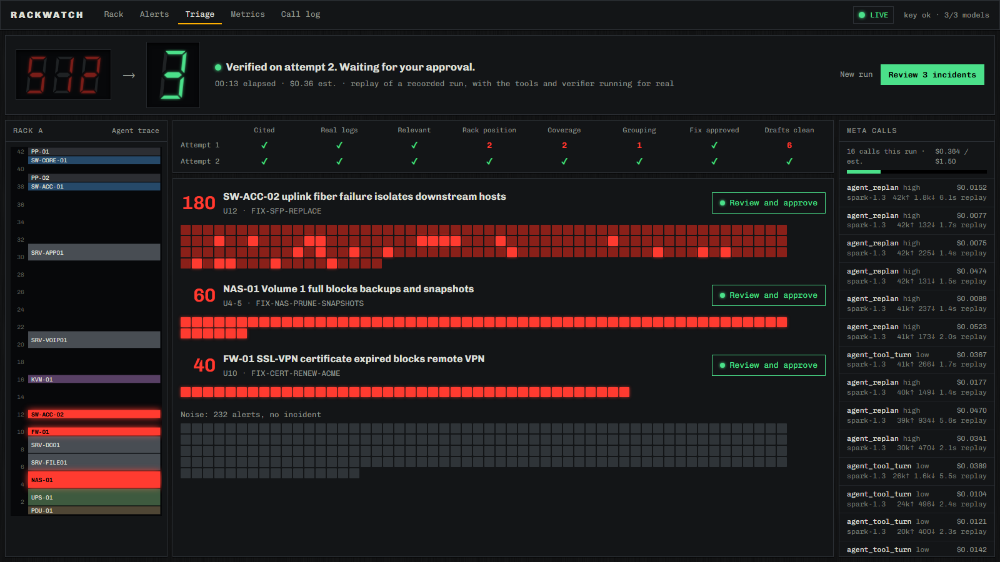
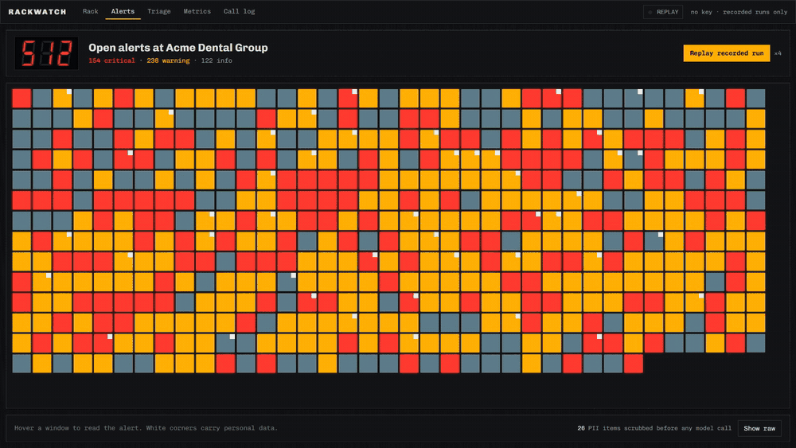

# RackWatch

> **Pre-existing vs. new:** Everything in this repository was created during the Meta Global AI Developer Hackathon, Nov 2–4, 2026. No pre-existing code is included. Public Meta docs and examples (meta-model-cookbook, legal-agent-workshop) were used as references and are credited in [THIRD_PARTY.md](THIRD_PARTY.md).

Snap a photo of a server rack and get a CMDB (configuration management database). Get hit with 512 alerts and get 3 verified incidents, each with a ticket and a client email waiting for a person to approve.





MSPs (managed service providers) run IT for dozens of small clients with a few techs on nights. One failed switch fires hundreds of alerts across everything behind it, and at 2 AM someone has to work out that it's one incident, find the cause, open a ticket and email the client without saying anything false. RackWatch does the legwork and shows its evidence. A person still signs off.

## Meta models used
| Model | Used for |
|---|---|
| `muse-spark-1.3` | Triage agent with tools, label reading, device grounding, effort routing, voice note work logs |
| Muse Spark Open | Meta's open-weight model, served by Baseten: the same triage agent, tools and verifier, as a choice next to `muse-spark-1.3` |
| `sam-3.1` | SAM (Segment Anything Model): segmenting each rack device, with concept and box prompts |
| `muse-voice-transcribe-1.0` | Tech voice notes, biased with keywords from the CMDB |
| Muse Code | Coding agent that wrote the vision pipeline and data generator ([session log](docs/muse-code-log.md)) |
| `muse-image-1.0` | Dev time only: made the sample rack image photorealistic |

Every runtime model call is Meta's, through one client, and the Call log screen shows all of them.

## Quick start
You need Python 3.11+ and Node 20+.

**No key: recorded runs**
```bash
python3 scripts/rw.py setup
python3 scripts/rw.py replay
```
Open http://127.0.0.1:8000 and click **Replay recorded run**. These are real recorded Meta calls. The tools and verifier run for real on your machine, and the screen says it's a replay. (`make setup` and `make replay` do the same.)

**Live**
```bash
cp .env.example .env
```
Add your `MODEL_API_KEY` to `.env`, then:
```bash
python3 scripts/rw.py dev
```
Live voice notes also need `ffmpeg`. A live triage costs about $0.30.

**On open weights**

Add `BASETEN_API_KEY` to `.env` and click **Live on open weights**, or run `python3 scripts/run_triage.py --engine open`. No key is needed for **Replay on open weights**. Setting `OPEN_PROVIDER=fireworks` with `FIREWORKS_API_KEY` uses Fireworks instead, which has passed tests with fakes but has not been run live.

## How it works
See [docs/architecture.md](docs/architecture.md) for the diagram.

1. **Rack to CMDB.** SAM 3.1 and Muse Spark find each device. Spark reads the labels and rail numbers, and a line fitted to those numbers decides each device's U position. Boxes are then snapped to that grid, so the overlay shows the decision and not SAM's raw box. Anything uncertain is flagged for review, and a person can correct any cell.
2. **Scrub.** Alerts and logs lose their PII (personally identifiable information) at ingest. Tokens like `<EMAIL_1>` map back only in a local table, and only after a person approves.
3. **Investigate.** The agent gets a digest, not 512 alerts, and works through tools: `cmdb_lookup`, `list_alerts`, `log_search`, `ping_sim`, `dns_sim`, `kb_search`, `draft_ticket`, `draft_client_email`, `submit_incidents`.
4. **Verify.** A plain Python verifier checks the submission. If it fails, the agent gets the reasons and re-plans, up to 3 attempts.
5. **Approve.** A person reads the evidence, adds a voice note if they're onsite, then approves or escalates. Only then can the ticket and email be exported.

## The verifier
The agent can't edit it, configure it, or call it except through `submit_incidents`. No tool can read ground truth.

| Rule | Checks |
|---|---|
| R1 citations exist | Every claim cites at least one log line |
| R2 citations real | Each cited line exists, and a `log_search` in this run returned it |
| R3 relevance | The line is from the root cause, an affected device or their uplink, within ±30 min of the alerts |
| R4 device resolves | The root-cause device is in the CMDB and the claims state its rack position in U (rack units) correctly |
| R5 coverage | Every alert is assigned exactly once |
| R6 grouping | Each incident matches a true incident (Jaccard ≥ 0.8) with the right root-cause device |
| R7 fix allowed | The fix is approved and addresses this cause, or the agent escalates |
| R8 drafts clean | Ticket cites 2+ logs. Email has no raw PII, log ids or jargon, in at most 180 words |
| R9 budget | Hard stop at the run cap, not a re-plan |

**An honest note on R6.** It compares against seeded ground truth, which is fair for a demo with seeded data and wouldn't exist on a real feed. Its feedback names conflicts, never answers: no truth ids, no expected device. With `production=True`, R6 and the truth half of R7 switch off and everything else still applies, which is a weaker check.

**The re-plan in the demo is real.** A rushed mode (`demo_strict`: low effort, 6 turns, first attempt only) often fails on its merits, so the rejection on screen actually happened. The shipped recording was kept because attempt 1 really failed (F1 0.59, 118 alerts unassigned, 8 drafts and positions wrong) and attempt 2 really passed. A normal run usually needs fewer attempts; see Results.

## PII
Deterministic regexes catch email, phone, MAC (media access control) addresses, card-like and SSN-like (Social Security number) numbers, IP (Internet Protocol) addresses outside lab ranges, `user <name>` and `Hi <Name>` patterns, plus the names in the PSA (professional services automation) contact list. `meta_client` scans every outgoing request and refuses the call if anything still matches. Client emails are de-tokenized locally, after approval. The token map never leaves the machine.

## Results
Measured on Nov 2, 2026 on the seeded dataset (seed 42), live. Raw numbers are in [docs/eval.json](docs/eval.json).

**Triage, 5 runs on each engine**
| | Muse Spark 1.3 (Meta API) | Muse Spark Open (Baseten) | Mixed |
|---|---|---|---|
| Passed the verifier | 5 of 5 | 5 of 5 | 5 of 5 |
| Passed on the first attempt | 2 of 5 | 1 of 5 | 1 of 5 |
| Mean attempts | 1.8 | 2.0 | 1.8 |
| Grouping F1 (the harmonic mean of pairwise precision and recall), mean | 0.996 | 0.996 | 1.0 |
| Time, mean (worst) | 58 s (74 s) | 38 s (51 s) | 138 s (152 s) |
| Estimated cost, mean (worst) | $0.30 ($0.32) | $0.18 ($0.27) | $0.37 ($0.52) |

The verifier didn't care which model answered: Meta's open-weight model passed it every time, and took less time and money doing it. Five runs is too few to rank the engines on quality, so read the first-attempt row as noise until there are more. Mixed sends low-effort tool turns to Muse Spark Open and everything else to Muse Spark 1.3. We expected it to be the cheapest, and it was the slowest and the most expensive: 70 of its 86 turns ran at high effort, so they stayed on the hosted model, and Baseten handled only 16. Don't use it.

**Rack scan, 5 runs of the sample image**
| | |
|---|---|
| Devices found at the right position | 11 to 14 of 14 (all 14 on 3 of 5 scans) |
| Whole U span right, top and bottom | 9 to 12 of 14 |
| Serial numbers read correctly | 10 to 12 of 14 |
| Flagged for a person to check | 4 to 7 per scan |
| Time | 138 s mean, 102 s to 224 s, mostly API latency |
| Estimated cost | $0.07 mean |

The usual miss is a 2U server recorded as 1U. In the scan we checked row by row, all three wrong devices were flagged for review, plus one that was right. Scans vary, so report the range. The shipped replay is the first take that reached 14 devices and 12 whole spans, which is better than typical, and its `meta.json` records how many takes that took.

Costs are estimates from published prices and the usage each response reports. Meta and Baseten publish the same token prices for these models, so the cost difference comes from using fewer tokens, not from a cheaper rate.

**Limits.** The dataset is synthetic, with three incidents and a known answer, so these numbers show the system works on this scenario and don't predict a real NOC (network operations center). The sample rack is a generated image with clean stickers, and a real closet photo will be harder. Reading a model number partly hidden behind cables is unreliable, and the table flags low-confidence cells.

## Cost and budget guard
`budget.py` refuses a call before it's made if its estimate would pass $1.50 for the run or $120 in total. Totals persist in the call log. Every call sets `max_output_tokens`. Prompt caching does much of the work here: in the shipped recording, 54% of input tokens were cached. Tests use a fake client and cost nothing.

## What Muse Code built
Muse Code wrote `backend/vision/` and `datagen/` in 5 logged sessions ([docs/muse-code-log.md](docs/muse-code-log.md)), and its commits carry `Agent: muse-code muse-spark-1.3`. Its work stops at those two packages. Run `scripts/agent_stats.sh` for its commit and line counts.

The contract came first (`backend/app/schemas.py`), Muse Code coded to it, and live runs drove the rest: every session after its first was a bug report with measured numbers from the integrator. Its third session made accuracy worse, which the same evaluation caught, and the next two fixed it. Where the build departed from the original spec, [docs/decisions.md](docs/decisions.md) says why.

## Tests
`pytest` covers every verifier rule with passing and failing fixtures, the PII scrubber (including false positives), tools, budget refusal, cassette round trips, scripted agent runs (pass, fail then re-plan, budget exhaustion), the API end to end in replay with no key, and the shipped recording itself. CI (continuous integration) runs them with no secrets, plus `ruff`, a secret scan and the frontend build.

## Data
Synthetic only, with no client PII. The rack image is generated, not a photo of real equipment. See [DATA.md](DATA.md).

## License
MIT for this code ([LICENSE](LICENSE)). Meta models and APIs are under Meta's terms. See [NOTICE.md](NOTICE.md), [SECURITY.md](SECURITY.md) and [THIRD_PARTY.md](THIRD_PARTY.md).

## Glossary
| Term | Meaning |
|---|---|
| API | Application programming interface |
| CI | Continuous integration |
| CMDB | Configuration management database |
| DNS | Domain Name System |
| F1 | The harmonic mean of precision and recall |
| IP | Internet Protocol |
| IT | Information technology |
| MAC | Media access control |
| MIT | The MIT open source license, named for the Massachusetts Institute of Technology |
| MSP | Managed service provider |
| NOC | Network operations center |
| PII | Personally identifiable information |
| PSA | Professional services automation |
| SAM | Segment Anything Model |
| SSN | Social Security number |
| U | Rack unit, the standard height of rack equipment |
