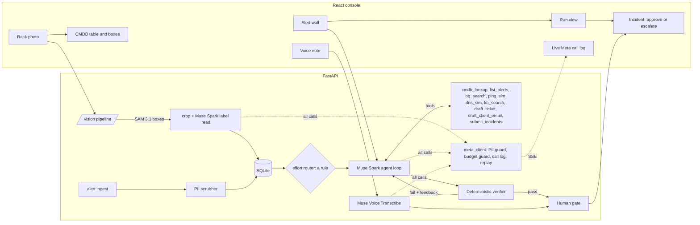

# Architecture

RackWatch turns a rack photo into a CMDB (configuration management database), then uses it to triage an alert storm for an MSP (managed service provider).

## The path of one alert storm

## One door to the model

`backend/app/meta_client.py` is the only code that talks to `api.meta.ai`, Meta's API (application programming interface). Before a request leaves it:

1. **PII (personally identifiable information) guard.** The payload's authored text (instructions, user messages, tool outputs) is scanned. A match refuses the call and logs `refused_pii`. The scrubber should already have caught it, so this is the second lock.
2. **Budget guard.** A cost estimate is checked against $1.50 per run and $120 total. A refusal ends the run as `budget_exceeded`; it is not a re-plan.
3. **Call log.** Every request becomes a row in `calls` and an SSE (server-sent events) event: model, purpose, effort, tokens, latency, estimated cost. The key and prompts are not stored, only a SHA-256 (Secure Hash Algorithm) digest of the request and at most 500 characters of the response.
4. **Replay.** In `replay` mode a cassette answers instead of the network, so the app runs with no key. Tools and the verifier still run for real. If a request differs from the recorded one, the entry is served and flagged `diverged`.

`FakeMetaClient` subclasses `MetaClient` and swaps only the transport, so tests exercise the same guards.

The triage agent can run on either of Meta's models: `muse-spark-1.3` on `api.meta.ai`, or Muse Spark Open, Meta's open-weight model, through an inference partner. Baseten is the default partner, and `OPEN_PROVIDER=fireworks` switches to Fireworks. `MetaClient` picks the endpoint from the model name, so all four steps above apply to both, and the call log records which endpoint served each call. The rack scan and voice notes stay on the Meta API, because SAM and Voice Transcribe are served there.

## Context strategy

The first message is a digest (counts by type, device and five-minute bucket, plus the top 50 distinct messages), not 512 alerts. The data sits behind tools. Spark's 1M context is a safety net here, not the plan. Prompt caching does the rest: the system prompt and tool block stay first, and prior turns replay unchanged, so the prefix keeps hitting the cache.

## Why the verifier is not a model

The agent cannot edit, configure or argue with `backend/app/verifier/verify.py`. It reaches it only by calling `submit_incidents`, and no tool can read ground truth. Failed checks go back as plain text and the agent re-plans, up to 3 attempts. R6 feedback names the conflict ("INC-1 merges alerts with different failure signatures. Compare: ...") without naming the answer.

## The seed and the scan

On the seeded rack, the CMDB rows the agent reads are the seed (DESIGN.md §8.2). A scan stores what vision read and diffs it for the accuracy number, and a seed row only gains its box and confidence, so a misread serial cannot change a triage. On any other photo, unmatched devices join the CMDB.

## Where things are

| Path | What |
|---|---|
| `backend/app/schemas.py` | The contract both agents coded to |
| `backend/app/meta_client.py`, `budget.py`, `replay.py`, `pii.py` | The door, its guards, and the scrubber |
| `backend/app/agent/` | Loop, tools, digest, selectors, effort router |
| `backend/app/verifier/verify.py` | R1–R8 |
| `backend/app/main.py`, `rack.py`, `voice.py`, `metrics.py` | API and orchestration |
| `backend/vision/`, `datagen/` | Written by Muse Code |
| `frontend/src/` | The console |
| `scripts/` | Preflight, eval, recording, cost report, task runner |
| `docs/decisions.md` | Where the build departed from the spec, and why |

## Glossary
| Term | Meaning |
|---|---|
| API | Application programming interface |
| CMDB | Configuration management database |
| DNS | Domain Name System |
| KB | Knowledge base |
| MSP | Managed service provider |
| PII | Personally identifiable information |
| R1–R9 | The verifier's rules, listed in the README |
| SAM | Segment Anything Model |
| SHA | Secure Hash Algorithm |
| SSE | Server-sent events |
| U | Rack unit |
| UI | User interface |
